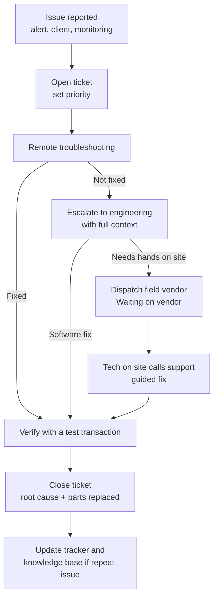

# Service Call Process

How a device issue moves from first report to closed ticket.

## Steps

1. **Open a ticket** for every issue, even if it seems small. Record the device ID, site, who reported it, symptoms and when it started.
2. **Set the priority** using the [priority matrix](ticket-priority-matrix.md).
3. **Troubleshoot remotely** with the [checklist](remote-troubleshooting-checklist.md). Note every step and result in the ticket.
4. **Escalate** to engineering if remote steps don't fix it. Include logs, screenshots, timeline and what you already tried.
5. **Dispatch a vendor** when hands are needed on site. Use the [dispatch template](vendor-dispatch-template.md), record the vendor's own ticket number, and set the ticket to *Waiting on vendor*.
6. **Guide the visit.** Ask the technician to call support from site so you can confirm the fix live before they leave.
7. **Verify** with a real or test transaction, not just a status light.
8. **Close** with the root cause, parts replaced, visit date and who did the work.
9. **Look for patterns.** Same device, same part, same symptom twice? Write a knowledge base article and flag it to engineering.

## Ticket statuses

| Status | Meaning |
| --- | --- |
| Open | Logged, not yet worked |
| In progress | Being troubleshot |
| Waiting on vendor | Field visit requested, waiting for a date or a report |
| Waiting on customer | Need info or access from the client |
| Resolved | Fixed and verified |
| Closed | Resolved and documented |
